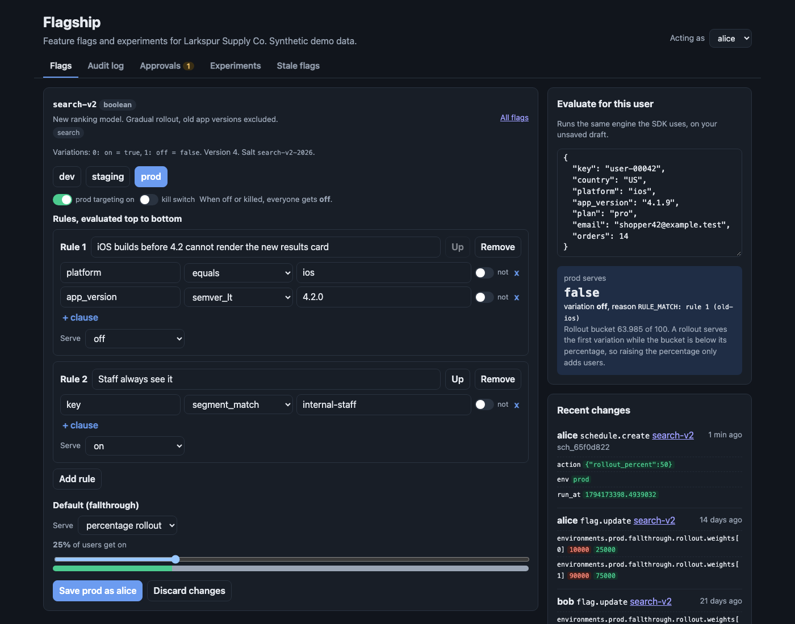
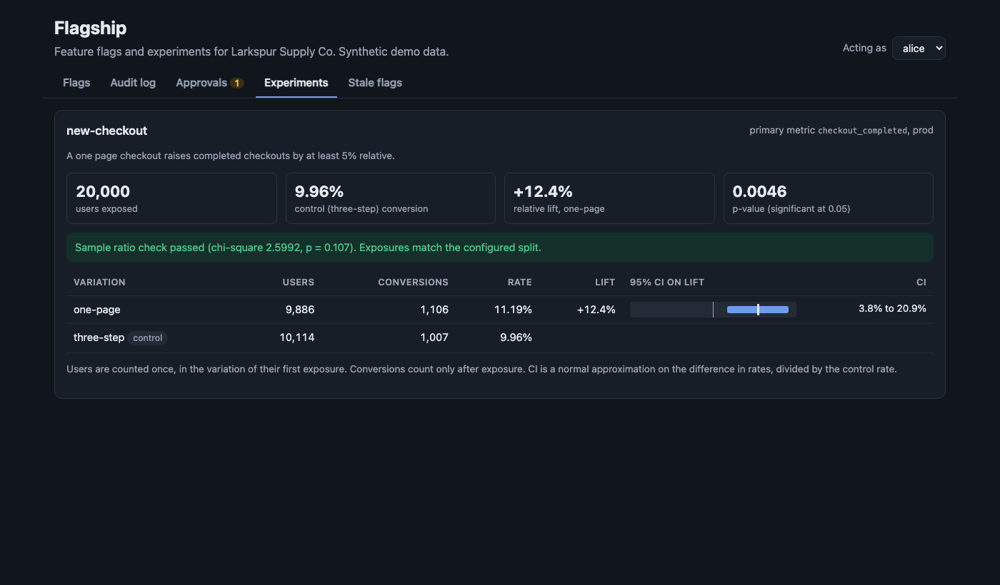
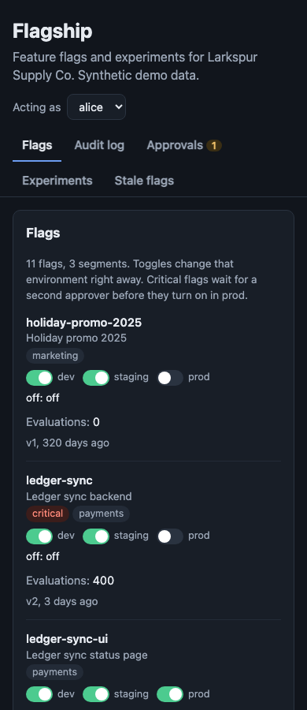
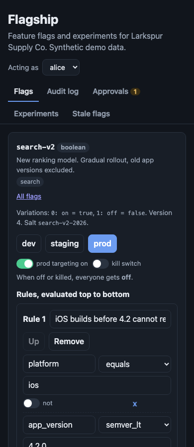
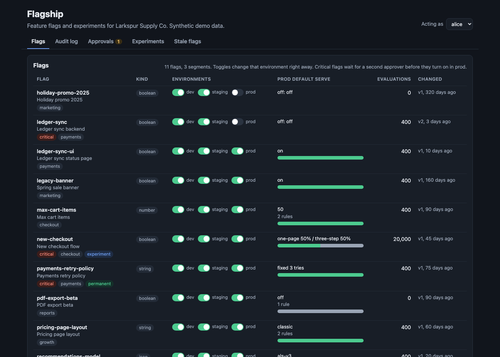
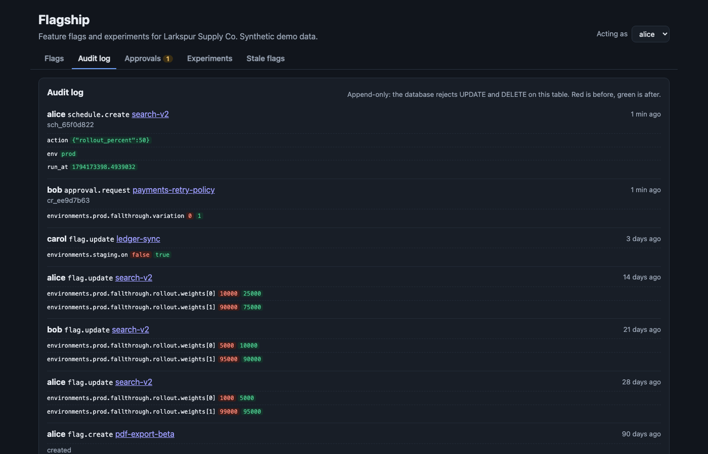

# Flagship

A feature flag and experimentation service: the internal platform that lets product teams ship code dark, roll it out to 1%, then 10%, then everyone, and turn it off in seconds without a deploy. It has a pure evaluation engine shared by the server and a Python SDK, targeting rules with 16 operators, reusable segments, deterministic percentage rollouts, prerequisites with cycle detection, scheduled changes, kill switches per flag and per environment, four-eyes approvals for critical flags in prod, an append-only audit log with diffs, Server-Sent Events that push changes to SDKs, experiment readouts with a sample ratio mismatch check, and a code scanner that finds flags safe to delete. The demo runs offline with synthetic data for a made-up online store, Larkspur Supply Co.



## How a rollout works

1. **Ship dark.** The `search-v2` code is merged behind `client.variation("search-v2", user, default=False)`. The flag exists in dev, staging, and prod, and prod is off, so production users get the code default.
2. **Target first.** A rule serves `on` to the `internal-staff` segment (anyone with an `@larkspur.test` email). Another rule, placed above it, serves `off` to iOS builds older than 4.2.0 (`semver_lt`), which cannot render the new results card. Rules run top to bottom and the first match wins.
3. **Roll out by percentage.** The default rule serves `on` to 1% of everyone else. Each user gets a bucket from 0 to 99.999: `sha1("search-v2" + salt + user key)`. A user is in when their bucket is below the percentage. The bucket never changes, so moving from 5% to 10% to 25% only adds users. Nobody flips back and forth.
4. **Schedule the next step.** A scheduled change raises the rollout to 50% at this time tomorrow. The scheduler applies it, writes it to the audit log as `scheduler (alice)`, and every connected SDK gets the new ruleset over SSE in about 30 ms on localhost.
5. **Kill it if something breaks.** Turning a flag off in prod never waits for approval, even for flags tagged `critical`. Turning it back on does.
6. **Clean up.** Once `search-v2` has served `on` to 100% for 30 days, `flagship scan` lists it with the exact file and line still referencing it, and CI posts the list to the job summary.

## Why

Without a flag service, every release is a deploy and every rollback is another deploy. Teams end up with config files edited by hand, no record of who turned what on, percentage rollouts that reshuffle users on every change, experiments read off dashboards with no check that the split is even working, and hundreds of dead flags nobody dares remove. This repo shows the moving parts that fix that, each one small enough to read and each one tested.

## Architecture

```
                    ┌──────────────────────────── Flagship server (FastAPI) ────────────────────────────┐
 web UI  ──────────▶│ /api/flags  /api/segments   validation, prerequisite cycle check                   │
 (x-actor)          │      │                      optimistic concurrency (version field, 409 on conflict)│
                    │      ▼                                                                             │
                    │ write path ──▶ critical flag + prod + not "turn off"? ──▶ change request (202)     │
                    │      │                                     second person approves ──┐              │
                    │      ▼                                                            ▼              │
                    │ commit: version+1, audit row with JSON diff (append-only triggers), revision+1     │
                    │      │                                                                             │
                    │      ├──▶ SSE hub ──▶ /sdk/stream  (full ruleset per environment, coalesced)       │
                    │ scheduler loop ──▶ due scheduled changes go through the same commit                │
                    │ /sdk/events ──▶ impressions + conversions ──▶ experiment readout, stale detection  │
                    │ /healthz  /metrics (Prometheus)  JSON logs                       SQLite (WAL)      │
                    └───────────────▲───────────────────────────────────▲──────────────────────────────┘
                                    │ GET /sdk/ruleset, SSE              │ batched events
                    ┌───────────────┴───────────────────────────────────┴──────────────┐
                    │ Python SDK: engine.evaluate() locally, no network call per check │
                    │ memory ──▶ last known good file ──▶ code default                 │
                    └──────────────────────────────────────────────────────────────────┘
```

| Piece | File |
|---|---|
| Evaluation engine, bucketing, cycle detection (pure, no I/O) | `src/flagship/engine.py` |
| Operators: equals, in, contains, starts_with, ends_with, matches (regex), lt, lte, gt, gte, between, semver_eq/lt/gt, before, after, segment_match | `src/flagship/operators.py` |
| Write-time validation | `src/flagship/validation.py` |
| Storage, approvals, schedules, audit, events (SQLite) | `src/flagship/store.py` |
| API, SDK endpoints, SSE hub, scheduler loop | `src/flagship/app.py` |
| Python SDK | `src/flagship/sdk.py` |
| Experiment math: lift, CI, z test, chi-square SRM (standard library only) | `src/flagship/stats.py` |
| Stale detection and code scanner | `src/flagship/stale.py`, `src/flagship/scan.py` |
| Synthetic store data and simulated A/B test | `src/flagship/seed.py` |
| Web UI (plain HTML and JS, light and dark) | `src/flagship/static/` |
| Example app using the SDK | `examples/shop/app.py` |

Every evaluation returns a value, a variation index, and a reason: `OFF` (with `killed` for a kill switch), `PREREQUISITE_FAILED`, `TARGET_MATCH`, `RULE_MATCH` (with rule index and id), `FALLTHROUGH` (with `in_rollout`), or `ERROR` (`FLAG_NOT_FOUND`, `USER_KEY_MISSING`, `MALFORMED_FLAG`, `PREREQUISITE_CYCLE`, `USER_ATTRIBUTE_MISSING`). Errors return the caller's default and never raise.

## Results

| Measure | Result |
|---|---|
| Evaluation speed (`flagship bench`, 11 demo flags, one core, Python 3.12, Intel i9-9980HK laptop) | about 35,000 to 40,000 evaluations per second, 25 to 30 microseconds each |
| Bucketing uniformity, 20,000 users in 10 bins | chi-square below 27.9 (p > 0.001), checked in tests |
| Rollout stability | every user enabled at 10% is still enabled at 20%, 50%, and 100% (5,000 users, tested) |
| SSE propagation, flag change to SDK on localhost | median 30 ms, max 32 ms over 20 changes |
| SDK with the server stopped | 100 out of 100 evaluations return the same values and reasons as before |

Simulated experiment on `new-checkout`: 20,000 synthetic shoppers, 50/50 split, control converts at 10%, the one-page checkout at 11.2% (a true 12% relative lift). Fixed seed, so the numbers are the same on every run.

| Variation | Users | Conversions | Rate | Lift | 95% CI on lift | p-value |
|---|---|---|---|---|---|---|
| three-step (control) | 10,114 | 1,007 | 9.96% | | | |
| one-page | 9,886 | 1,106 | 11.19% | +12.4% | +3.8% to +20.9% | 0.0046 |

Sample ratio check: chi-square 2.60, p = 0.107, no mismatch. The test suite also feeds a broken 58/42 split into the readout and checks that it is flagged.



The UI also works at phone width with no sideways scrolling (`make check-mobile` measures every page at 390px):

<p> </p>

## How to run

Requires [uv](https://docs.astral.sh/uv/). Docker is optional and not needed for anything below.

```bash
make install            # uv sync --python 3.12
make run                # server and UI on http://127.0.0.1:8788, seeds demo data on first start
```

In a second terminal, run the example storefront against it, then stop the server and watch the shop keep serving:

```bash
make shop               # prints one JSON line per 10 shoppers, including the SDK status
```

Other commands:

```bash
make test               # 94 tests
make lint               # ruff
make bench              # evaluations per second
make scan               # stale flag report for examples/shop
make check-mobile       # fails if any UI page overflows sideways at 390px (needs make run and Chrome)
make screenshots        # README images with headless Chrome (needs make run)
make demo-reset         # delete the local database so the demo seeds again
```

With Docker (built in CI, not run on the author's machine):

```bash
docker compose up --build              # server on :8788 plus the example shop using the SDK
docker compose stop flagship           # the shop keeps going on its last known good ruleset
docker compose start flagship          # it reconnects and resyncs
```

### Try the four-eyes rule

1. Open `#/flag/new-checkout` acting as alice, move the rollout slider, and save. The flag is tagged `critical`, so the save returns 202 and a change request.
2. Open Approvals. The approve button is disabled for alice. Switch "Acting as" to bob and approve. The change is applied with a note `approved by bob`, and both steps are in the audit log.





### API and SDK

```bash
curl -s -H 'authorization: sdk-prod-demo' localhost:8788/sdk/ruleset         # server key: full ruleset
curl -s -X POST -H 'authorization: client-prod-demo' -H 'content-type: application/json' \
  -d '{"context":{"key":"user-1","country":"US"}}' localhost:8788/sdk/evaluate  # client key: values only
curl -s -X POST -H 'x-actor: carol' -H 'content-type: application/json' \
  -d '{"on": false}' localhost:8788/api/flags/legacy-banner/environments/prod  # kill switch
curl -s localhost:8788/api/experiments/new-checkout
curl -s localhost:8788/metrics
```

```python
from flagship.sdk import FlagshipClient

client = FlagshipClient("http://127.0.0.1:8788", "sdk-prod-demo", cache_path=".flagship-cache.json")
detail = client.variation_detail("search-v2", {"key": "user-42", "platform": "ios", "app_version": "4.1.9"}, False)
print(detail.value, detail.reason)  # False {'kind': 'RULE_MATCH', 'rule_index': 0, 'rule_id': 'old-ios'}
client.track("checkout_completed", {"key": "user-42"})
```

Demo keys are `sdk-<env>-demo` (server) and `client-<env>-demo` (client) for dev, staging, and prod. Set `FLAGSHIP_KEYS` to replace them and `FLAGSHIP_ADMIN_TOKEN` to require a bearer token on the management API. See `.env.example`.

### Stale flags in CI

```bash
uv run flagship scan examples/shop --flags examples/flags-export.json --format markdown
```

The CI job appends this report to `$GITHUB_STEP_SUMMARY`. On the example app it finds 3 stale flags out of 11: `pdf-export-beta` (never evaluated, no code references, safe to remove now), plus `legacy-banner` and `holiday-promo-2025` (constant for 160 and 320 days, still referenced at `app.py:34` and `app.py:36`, so the code goes first). It also reports `gift-wrap`, a key the code asks for that does not exist on the server. Flags tagged `permanent` (operational kill switches, config) are never reported. Point `--server http://host:8788` at a live server instead of an export file.

## Tests

94 tests (`uv run pytest -q`, about 10 seconds):

- **Engine (48):** every operator, including semver pre-release ordering, regex errors, dates as ISO strings and epoch milliseconds, and type mismatches; rule order and AND within a rule; negation; nested attributes; segments with include, exclude, and rules; targets; kill switch; error reasons; bucketing determinism, stability as the percentage grows, uniformity (chi-square), multivariate splits, bucketing by another attribute; prerequisites and cycles.
- **Server (28):** validation of bad flags (9 cases), cycle rejection on write, optimistic concurrency (409 and 428), audit diffs and append-only triggers, approvals (requester cannot approve, stale requests, rejection, staging and turn-off skip approval), scheduled changes in order with a fake clock, schedules on critical flags waiting for approval, segments, server vs client SDK keys, draft evaluation, health, metrics, no-op writes.
- **SDK (6), against a real uvicorn server on a thread:** SSE update propagation; the app keeps working when the server dies (memory, then the last known good file in a new process, then code defaults); reconnect with backoff and resync after a restart; impression batching and summarizing; bounded event queue; prerequisite impressions.
- **Experiments (7):** chi-square p-values against table values, lift and CI formulas, SRM detection, conversions counted only after exposure, the simulated experiment recovering the true lift inside its CI.
- **Stale and scanner (5):** constant at 100% and 0%, rules make a flag non-constant, never and not recently evaluated, permanent flags skipped, scanner buckets and skipped directories, the CLI on the example app.

## Production notes

- **Storage and fan-out.** SQLite and one process are fine for a demo. At scale the flag store goes to Postgres, and SSE runs on a separate fleet fed by a pub/sub topic, with SDKs behind a CDN or relay proxy so a million SDK instances do not hold connections to the write API. Pushes would be deltas with a revision number instead of the full ruleset.
- **Events.** Impressions would go to a queue (Kafka or Kinesis) and a warehouse, not SQLite. The SDK already summarizes per user and flag; a real one would also sample, and the readout would run as a scheduled job with sequential testing or CUPED instead of a single fixed-horizon z test.
- **Auth.** The `x-actor` header stands in for SSO. Real approvals need identities from the IdP, roles per project and environment, and SDK keys stored hashed with rotation.
- **Safety.** Add automatic rollback guards: watch error rate and latency per variation and turn a flag off when a rollout makes them worse. Scheduled changes would also check the guard before each step.
- **More SDKs.** The engine is pure and its test cases are data, so the same cases can drive a Go or TypeScript SDK and prove they bucket users identically.
- **Retention.** The audit log is append-only in the database, but it should also be shipped to write-once storage so a database admin cannot rewrite history.

## License

MIT. See [LICENSE](LICENSE).
